# Vidya Setu - System Architecture Document

## 1. Executive Summary & Product Context

**Vidya Setu (विद्या सेतू)** is an offline-first learning and school management platform purpose-built for rural and remote schools across India. In typical rural schooling environments:
- Continuous internet connectivity is absent for days or weeks at a time.
- Power grids can be intermittent, running on solar backup or battery banks.
- A single shared tablet or low-spec Android device (2 GB RAM) serves an entire classroom or multi-grade cohort.
- Digital literacy among primary school students and guardians is minimal; language diversity demands native regional scripts (Hindi, Marathi, English) with voice and audio scaffolding.
- Strict data privacy guidelines under India's **Digital Personal Data Protection (DPDP) Act 2023** forbid unnecessary collection or retention of sensitive citizen identification numbers (e.g., Aadhaar).

To solve these constraints, Vidya Setu is engineered as a **three-tier offline-first distributed system**:
1. **Tier 1 (Student/Teacher Devices)**: Progressive Web Application (PWA) running on low-spec tablets and phones via Dexie.js (IndexedDB), Service Worker precaching, and Web Speech API. Every user write is local-first.
2. **Tier 2 (School Hub)**: Lightweight Node.js microservice running on a spare classroom desktop, laptop, or low-cost hardware (e.g., Raspberry Pi or Android via Termux). Serves local REST APIs, caches compressed media, and coordinates two-way synchronization over local Wi-Fi without internet.
3. **Tier 3 (Cloud API)**: Production-grade cloud service deployed on PostgreSQL 16, Redis/BullMQ, and MinIO/S3. Aggregates district-wide metrics, runs asynchronous FFmpeg video transcoding, and dispatches multi-channel parent notifications.

---

## 2. Three-Tier Architectural Topology

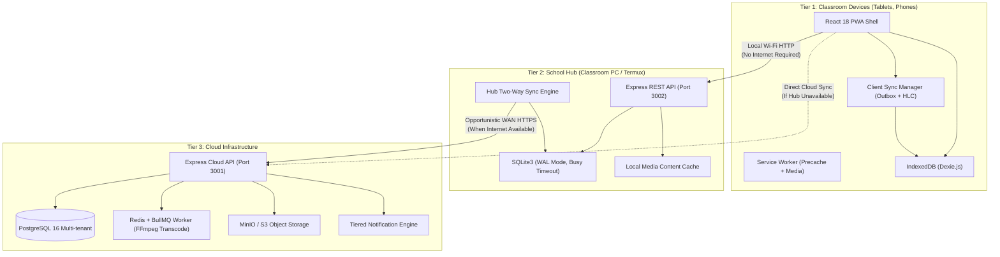

---

## 3. Comprehensive UML Diagrams & Code Module Mappings

### 3.1. Use Case Diagram

The use case diagram illustrates user interactions across all five specialized personas: **Student**, **Teacher**, **Parent/Guardian**, **Content Administrator**, and **District Administrator**.

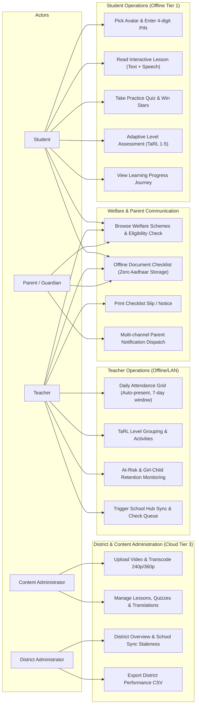

**Direct Code Module Mapping:**
- `UC1 - UC5`: `apps/web/src/screens/student/` (`StudentProfilePicker.tsx`, `StudentHome.tsx`, `LessonReaderScreen.tsx`, `QuizRunnerScreen.tsx`, `AdaptiveAssessmentScreen.tsx`).
- `UC6 - UC9`: `apps/web/src/screens/teacher/` (`TeacherAttendanceScreen.tsx`, `TeacherTaRLScreen.tsx`, `TeacherAtRiskScreen.tsx`, `TeacherHubStatusScreen.tsx`).
- `UC10 - UC12`: `apps/web/src/screens/schemes/SchemesBrowserScreen.tsx`, `packages/shared/src/domain/schemes.ts`.
- `UC13`: `apps/api/src/services/notification.service.ts` (4-tier fallback: On-Device -> Print Slip -> SMS -> Community Notice Board).
- `UC14 - UC15`: `apps/web/src/screens/admin/ContentAdminScreen.tsx`, `apps/api/src/services/content.service.ts`.
- `UC16 - UC17`: `apps/web/src/screens/district/DistrictDashboardScreen.tsx`, `apps/api/src/services/district.service.ts`.

---

### 3.2. Domain Class Diagram

Every entity in the Vidya Setu domain model inherits base synchronization metadata: `id` (RFC 9562 UUIDv7), `schoolId`, `createdAt`, `updatedAt`, `deletedAt` (soft delete), `version`, and `deviceId`.

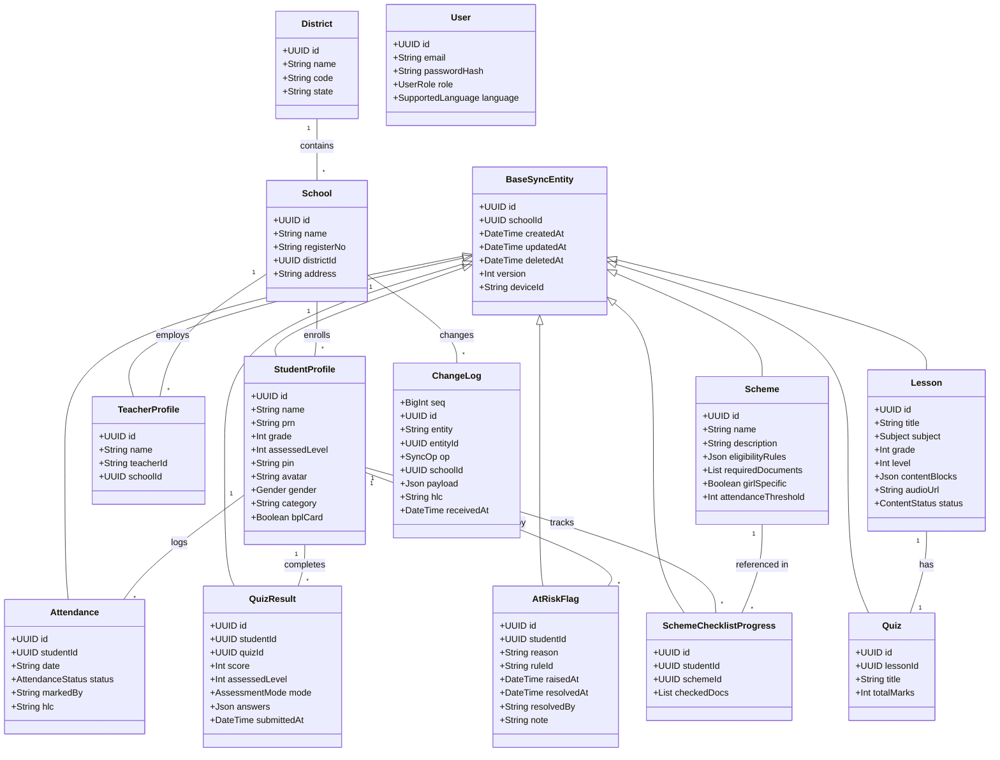

**Direct Code Module Mapping:**
- Prisma Model Definitions: `apps/api/prisma/schema.prisma`.
- SQLite DDL Migrations: `apps/hub/src/db/migrations/001_initial_schema.sql`.
- IndexedDB Dexie Schema: `apps/web/src/db/offline-db.ts`.
- Core Shared Types: `packages/shared/src/types/index.ts`.

---

### 3.3. Package Diagram & Boundary Enforcement

The repository follows a clean, strict monorepo boundary managed by **pnpm workspaces**. Application packages are prohibited from cross-importing each other; all shared domain engines, schemas, and protocol definitions reside in `packages/shared`.

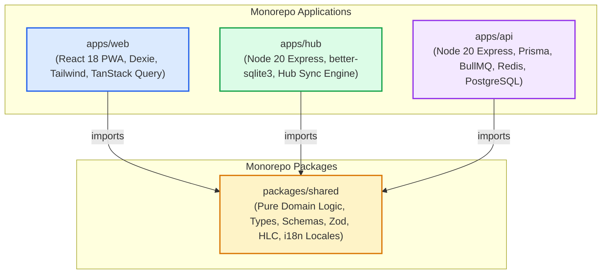

**Layering Principles Enforced in Code:**
1. **Controllers** never interact directly with database models or query builders; they validate input with Zod and delegate to Services.
2. **Services** contain business logic (e.g., 7-day attendance edit window, TaRL staircase calculation, at-risk triggers) and invoke Repositories.
3. **Repositories** encapsulate raw ORM and SQL queries (Prisma for Cloud, `better-sqlite3` for Hub, Dexie for Web).
4. **Shared Package** contains zero external infrastructure dependencies (no database drivers, no DOM dependencies, 100% pure TypeScript).

---

### 3.4. Component Diagram

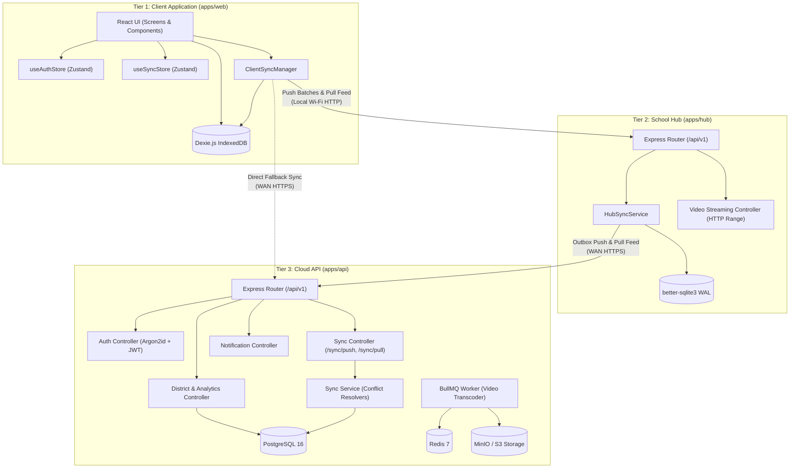

---

### 3.5. Composite Structure Diagram: School Hub Internal Architecture

The School Hub is an autonomous appliance designed to operate without internet supervision.

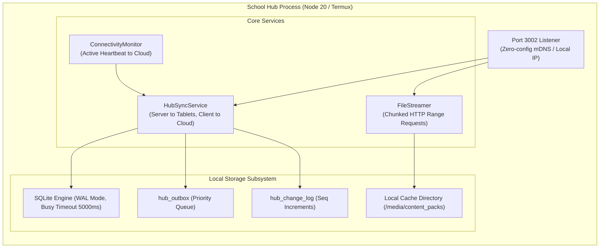

**Key Operational Properties:**
- **Crash Resistance**: SQLite in `WAL` (Write-Ahead Logging) mode ensures immediate durability during sudden rural power cuts.
- **Dual Personality**: Acts as a **Server** when receiving tablet pushes, and as a **Client** when pushing outbox batches to the cloud.

---

### 3.6. Deployment Diagram

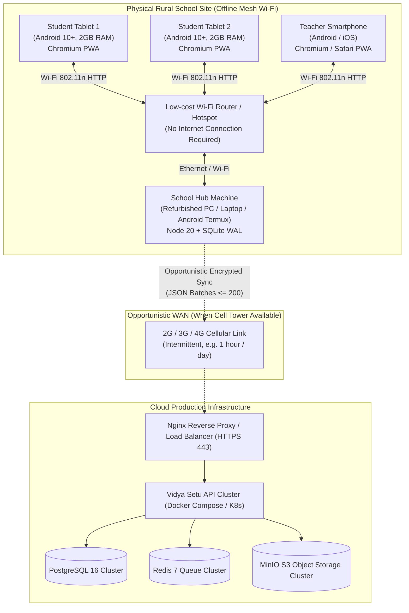

---

### 3.7. State Transition Diagrams

#### 3.7.1. Student Adaptive Assessment Progression (TaRL staircase)

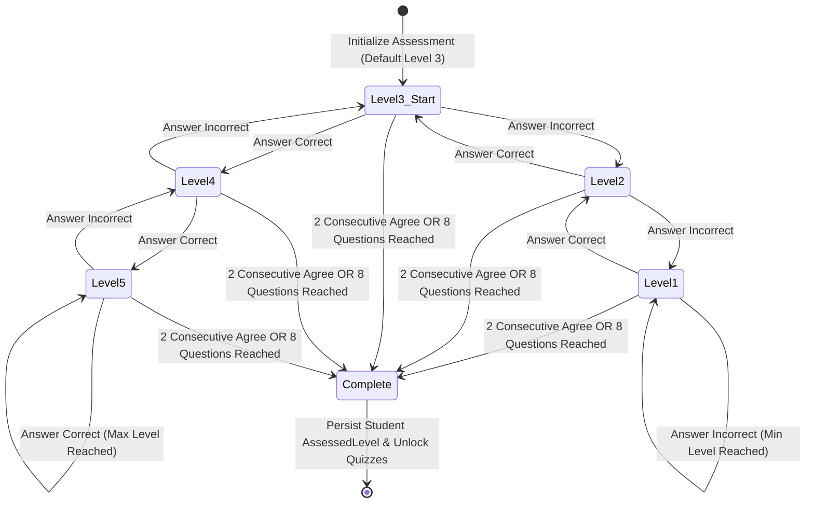

#### 3.7.2. Outbox Mutation Lifecycle (Zero Data Loss)

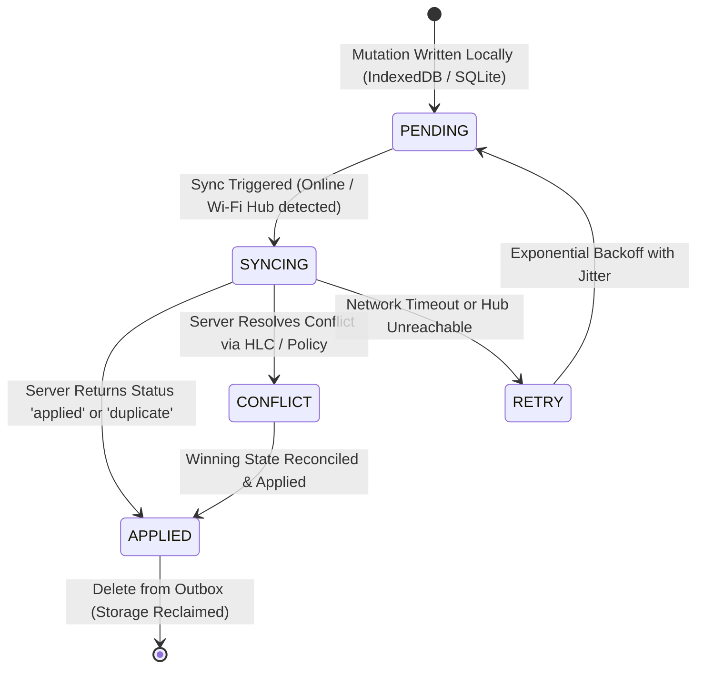

#### 3.7.3. Video Transcoding Lifecycle

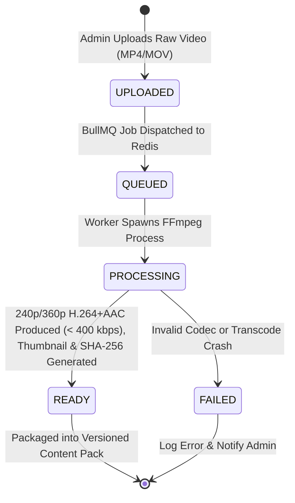

---

### 3.8. Activity Diagram: Offline Attendance to Cloud At-Risk Evaluation

This sequence illustrates how a teacher marks attendance without internet, how the outbox guarantees delivery, and how the cloud evaluates retention triggers.

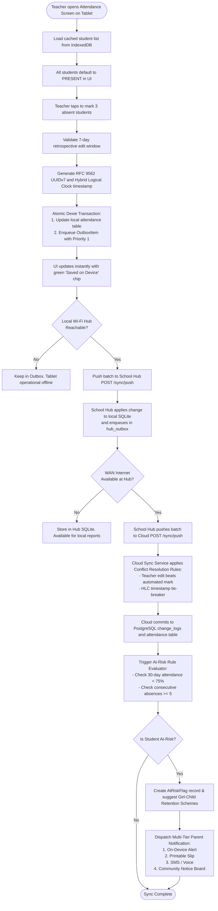

---

## 4. Privacy, Security & DPDP Act 2023 Compliance

Vidya Setu strictly adheres to India's **Digital Personal Data Protection Act (2023)** and digital safety standards for minors:
1. **Zero Government ID Storage**: The platform **never collects, stores, transmits, or asks for** Aadhaar numbers, PAN numbers, or bank account numbers. Government welfare scheme eligibility helpers track only *document checklist readiness* (e.g., `["Aadhaar Card", "Ration Card", "Bank Passbook"]` with boolean checkmarks), storing no sensitive identifier strings.
2. **Local Multi-Student PIN Isolation**: Shared classroom tablets protect student accounts using a friendly visual avatar + 4-digit PIN verified against local salted credentials.
3. **Tenant & School Scoping**: All API queries, SQLite tables, and PostgreSQL relations enforce explicit `schoolId` scoping. Data cannot bleed across schools or administrative districts.
4. **Data Minimization & Right to Erasure**: Dedicated REST endpoints (`DELETE /api/v1/students/:id`, `GET /api/v1/students/:id/export`) allow immediate erasure of pupil records or machine-readable export upon guardian request.
