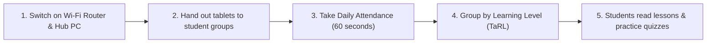

# Vidya Setu - Teacher Quickstart Guide (शिक्षकांसाठी मार्गदर्शिका)

Welcome to **Vidya Setu (विद्या सेतू)**! This guide is designed to help teachers conduct daily classroom activities smoothly, even with **no internet access**.

---

## 🌅 Morning Classroom Routine (दैनिक सकाळची दिनचर्या)

---

## 📋 Step 1: Marking Attendance in 60 Seconds (हजेरी घेणे)

Taking attendance on Vidya Setu is fast and requires zero typing:

1. Tap **Attendance (हजेरी)** in the bottom navigation bar.
2. Select your class grade (e.g., Grade 3).
3. **Everyone is marked Present (हजर) by default!**
4. Simply tap on any student who is absent today to mark them **Absent (गैरहजर)** (changes to red).
5. If you made a mistake, tap **Undo** or tap the card again to restore them to Present.
6. Look at the top bar: you will see a green chip: **"Saved on this device" (या उपकरणावर जतन केले)**.
7. You are done! Your attendance is safely saved offline on your device.

> **Tip:** You can edit attendance for any of the past **7 school days** if a student brings an excuse slip later.

---

## 🎯 Step 2: Teaching at the Right Level (TaRL स्तर गट)

In rural multi-grade classrooms, students often have different reading and math levels. Vidya Setu groups students by their actual ability rather than just their age:

1. Tap **Level Groups (स्तर गट)** in the teacher navigation.
2. View students automatically sorted into 5 levels:
   - **Level 1 (अक्षर व ध्वनी / Letters & Sounds)**: Beginner phonics.
   - **Level 2 (शब्द वाचन / Word Reading)**: Simple 2-3 letter words and single-digit counting.
   - **Level 3 (वाक्य वाचन / Sentence Reading)**: Short sentences and basic arithmetic.
   - **Level 4 (परिच्छेद वाचन / Paragraph Reading)**: Multi-sentence stories and multiplication.
   - **Level 5 (कथा व आकलन / Story & Comprehension)**: Advanced comprehension and problem solving.
3. Tap **View Suggested Activities (शिफारस केलेले उपक्रम)** for practical, low-cost group activities (using chalk, stones, flashcards, or group reading).
4. As a teacher, you can tap **Adjust Level** if you observe that a student is ready to advance!

---

## 🛡️ Step 3: Monitoring At-Risk & Girl-Child Retention (विद्यार्थी उपस्थिती रक्षण)

Every child belongs in school. Vidya Setu automatically flags students who may be at risk of dropping out:

1. Tap **At-Risk Alerts (लक्ष देण्याची गरज)** in the teacher menu.
2. Look for students flagged with:
   - **Low Attendance (< 75% over past 30 days)**.
   - **5 or more consecutive days of unexplained absence**.
3. For girl students, the system automatically highlights **Girl-Child Special Schemes (मुलींसाठी विशेष योजना)** such as free bicycle distribution, Savitribai Phule scholarship, or attendance stipends.
4. After speaking with the student's family, enter a short note (e.g., "Spoke with mother; child was helping with harvest, returning Monday") and tap **Resolve (पूर्ण झाले)**.

---

## 📑 Step 4: Helping Parents with Welfare Schemes (कल्याणकारी योजना व कागदपत्रे)

Parents often visit the school asking about government scholarships, uniforms, and mid-day meal allowances:

1. Tap **Government Schemes (सरकारी योजना)**.
2. Use the **Eligibility Helper (पात्रता तपासणी)**:
   - Answer 3 quick questions: Grade, Gender, and Category/BPL status.
   - The app instantly filters applicable central and state schemes.
3. Review the **Required Documents Checklist (आवश्यक कागदपत्रे)** with the parent.
4. Tap the checkmarks as the parent produces each document (Ration Card, Passbook, Photograph).
5. Tap **Print Checklist (कागदपत्र यादी प्रिंट करा)** to give the parent a take-home slip with instructions on where to apply (Gram Panchayat or Taluka Block Education Office).

> ⚠️ **Important Privacy Rule:** Never ask for or type the student's 12-digit Aadhaar number into the application. Only check off whether the document is ready.

---

## 🔄 Step 5: End of Day Synchronization (दिवसाअखेर डेटा सिंक)

1. Make sure your tablet is connected to the classroom Wi-Fi.
2. Look at the sync chip in the top header:
   - 🟢 **Synced (सिंक झाले)**: All changes are safely stored on the School Hub PC.
   - 🟡 **Pending Changes (प्रलंबित बदल)**: Changes are stored on the tablet and waiting to upload.
3. Tap **Sync Status** and click **Sync Now (आता सिंक करा)**.
4. If your school has internet or when the teacher takes their phone into town, the Hub will automatically forward the day's attendance to the District Education Office!
